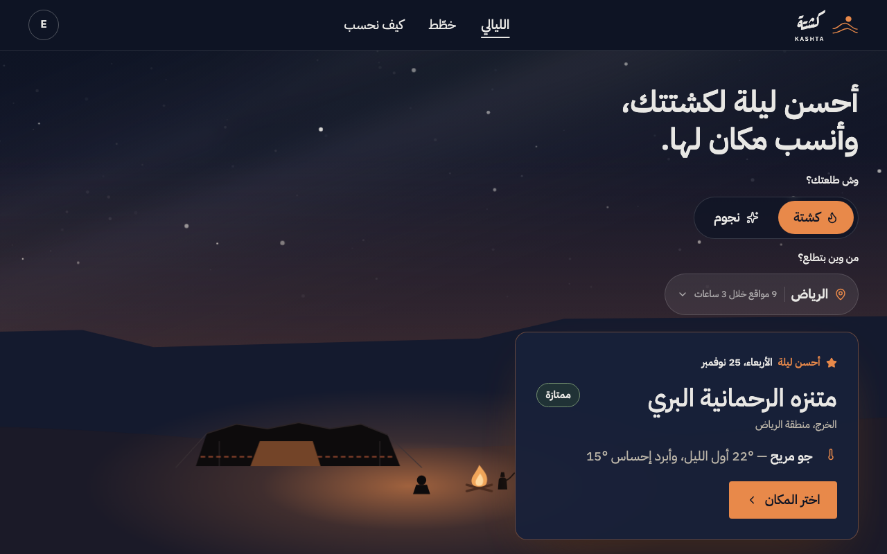
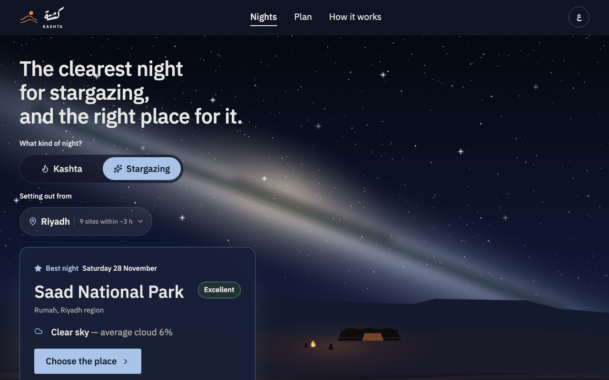
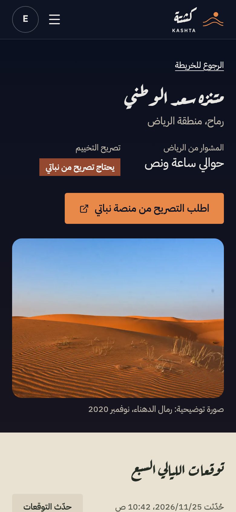
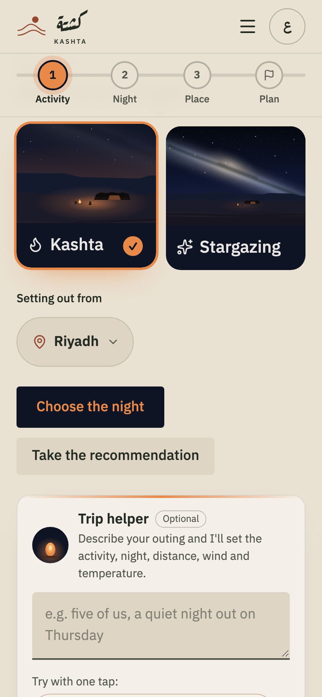
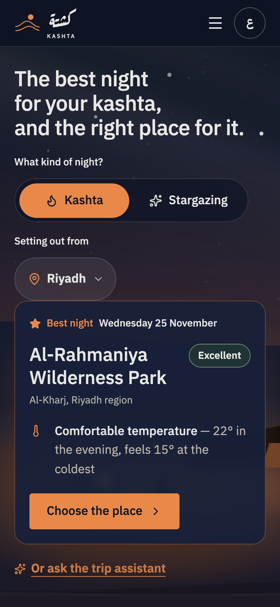

# KASHTA | كشتة

**Pick the best night this week, and the right place, for a Saudi desert trip.**

**Live:** https://4kashta.vercel.app

<p align="center">
  
  
</p>

## Try it in 30 seconds

1. Open the [live site](https://4kashta.vercel.app). It starts in Arabic; tap **E** for English.
2. Choose **Kashta** (campfire night) or **Stargazing**, and your starting city.
3. Look at the best place for tonight, or tap another night in the 7-night bars.
4. Tap **Choose the place**, then **Use this place**. Your plan opens; tap **Copy trip link** to share it.
5. Optional: ask the **trip assistant**, or tap a starter like "Friday night, six of us".

## What it does

- Compares the next 7 nights using real forecasts (temperature, wind, rain, cloud, dust, moonlight) and rates every night with complete data. Dust forecasts are shorter, so the last nights often show as incomplete.
- Covers 62 camping sites in 9 regions from the official NCVC *Camping and Caravan Guide 2025*.
- Starts from one of 7 cities and estimates drive time (straight line × 1.3, labelled as an estimate).
- Place pages: 7-night forecast, hourly chart, permit status with its source, and a packing checklist saved on your device.
- Two activities, scored differently: a kashta favours comfort and calm wind; stargazing favours clear, dark skies.
- An optional Llama 4 Scout assistant turns a sentence into settings and explains the result. It never sets the scores.

What it does **not** do: it doesn't issue permits (it links to [Nabati](https://nabati.ncvc.gov.sa)), it doesn't measure light pollution, and the photos show the region's terrain, not the exact sites.

<p align="center">
  
  
  
</p>

## How it works

- **Scores are plain code** (`src/lib/score.ts`): each forecast value maps to 0–100, weighted by activity. A dangerous condition caps the score. Missing data shows "incomplete" instead of a guess.
- **Weather:** [Open-Meteo](https://open-meteo.com) forecast and air quality (CC BY 4.0), cached for 30 minutes. **Moon and twilight:** [SunCalc](https://github.com/mourner/suncalc).
- **AI is checked before it is shown:** replies must pass a Zod schema, numbers not in the forecast are removed, and suggested places must be real candidates (`src/lib/ai-guards.ts`).

Stack: Next.js 16 · React 19 · TypeScript · Tailwind CSS 4 · Zod · Llama 4 Scout (Cloudflare Workers AI). No database.

## Run locally

```bash
npm install
cp .env.example .env.local   # optional: add CLOUDFLARE_ACCOUNT_ID and CLOUDFLARE_API_TOKEN for the assistant
npm run dev                  # http://localhost:3000
```

Without AI keys, everything works except the assistant, which says it is not set up.

Checks: `npm run lint` · `npm run typecheck` · `npm test` · `npm run build`

## Credits

Site list: NCVC Camping Guide 2025 (checked 2026-11-02; permits change each season). Weather: Open-Meteo. Photos: Wikimedia Commons, listed on [/about](https://4kashta.vercel.app/about#credits).

Built for Project 4 (Meta × Startupbootcamp × Tuwaiq Academy).
